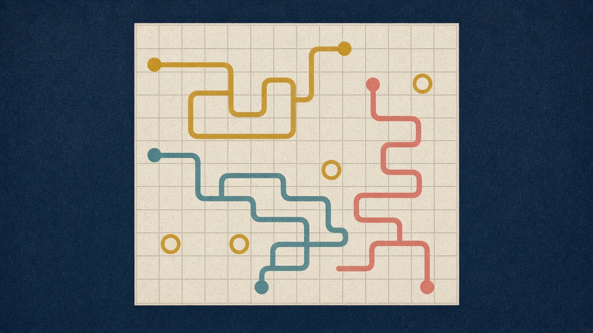
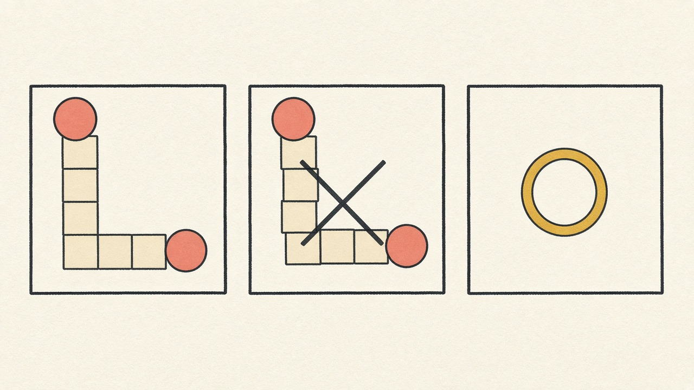
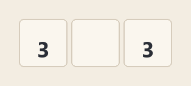
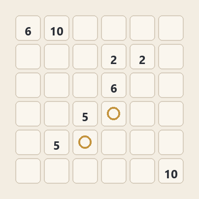
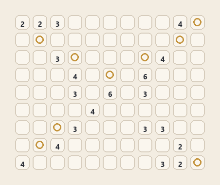
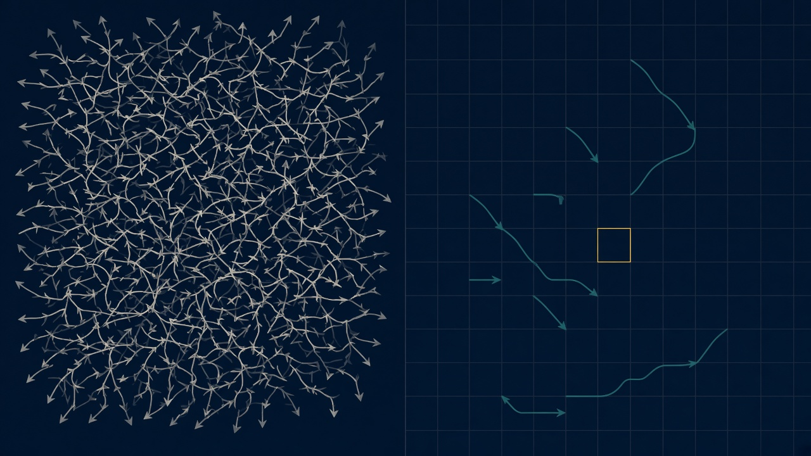

# Logipix

Java solver for Logipix path puzzles, written in 2022 by Alhussein Jamil and Jia Jean Law.



A cell holding a positive number *n* must be joined to exactly one other *n* by a path of *n* cells, counting both ends. Paths do not cross or share a cell. Zero is an empty cell a path may cross. A one occupies only its own cell.

## The rule



The left panel is a legal join: the path runs from one end to the other and stays on the grid. The middle panel is rejected: the route never meets its other end. The right panel is a 1, which is already a finished path of one cell.

```text
3 1
3 0 3
```

That file is a single row. The two 3s must cover the zero between them. The finished row is start, straight on, end.



## Watching a solution

Each color is one pair. The number stays on the two ends. A gold ring is a 1. Empty squares are zeros the paths did not need.

The 6×6 board has four pairs. The short 2s lock first, then the 5s, the 6s, and the 10 that walks the border.



The 11×9 board has ten paths. They are drawn the same way: pick a pair, grow the route, then move to the next open clue.



[`puzzles/logix.txt`](puzzles/logix.txt) holds the original ten boards, from 3×3 through 30×35. Nine of them have a solution. The 40×24 board does not: one 2 and one 3 cannot reach another cell of the same value in the required number of steps, so the program prints `NO SOLUTION` at once.

## How a board is solved



The left side is the old cost: every walk out of a clue, most of which never arrive at a partner. The right side is the search that ships now. Only routes that already join two equal clues are kept, and the gold cell is the next clue to place, the one with the fewest routes still open.

For every clue *n* greater than 1:

1. Group the cells that contain *n*. An odd count means the board is impossible.
2. Keep a pair only when the Manhattan distance is at most *n − 1* and the leftover steps are even. A grid path cannot change length by one.
3. Walk from one cell to the other through zeros, never revisiting a square, and prefer steps that move toward the partner. Each accepted walk has exactly *n* cells.
4. Assign those walks so every clue is used once and no square is used twice. The clue with the fewest remaining walks is tried first. If that clue has none, the branch is dead.

Ones are marked before the search. They are obstacles to every other path.

## What changed from the 2022 search

The 2022 program, `Main` plus `solver`, did the work in the other order.

It stood on a clue and counted in base 4. The digits were right, down, left, and up. It skipped a step that immediately reversed the previous one, stored every surviving string, and only afterwards asked whether that string ended on the matching number. Clues were then tried from small to large. A second pass tried to reserve any square that lay on every remaining walk, but the reservation was applied only to the last square of each walk, so almost nothing was forced. Every attempt also copied the whole color grid.

That search is complete in principle and very large in practice. A clue of 12 already has on the order of a quarter-million direction strings before the board is allowed to reject them. On the 20×20 board the original loop did not finish in three minutes.

The solver in this repository never builds those strings. A walk is born already aimed at one partner, and it is discarded as soon as it cannot arrive on time. What remains is a covering problem: choose one recorded route per clue so the routes do not touch. The same rules decide correctness. When several layouts are legal, the picture may differ from the 2022 printout; both are solutions if every clue is paired, every path has the right length, and nothing overlaps.

## Build and run

JDK 17 or newer. The Maven Wrapper is included, so a separate Maven install is optional.

```bash
./mvnw -B package
java -jar target/logipix-1.0.0.jar puzzles/logix.txt
```

On Windows, use `mvnw.cmd` instead of `./mvnw`. With no argument, the program reads `puzzles/logix.txt` from the current directory.

Each puzzle prints a board and the runtime in milliseconds, or `NO SOLUTION`.

| Glyph | Meaning |
| --- | --- |
| space | empty |
| `@` | a 1 |
| `►` `▼` `◄` `▲` | start of a path |
| `→` `↓` `←` `↑` | continuation |
| `●` | end of a path |

## Tests

```bash
./mvnw -B verify
```

The tests solve every bundled board, check the path rules on the result, and require each board to finish in under a second.

## License

MIT. Copyright (c) 2022 Alhussein Jamil and Jia Jean Law. See [LICENSE](LICENSE).
